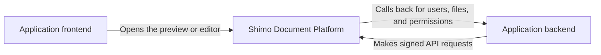

# Product overview and integration scenarios

[Home](../README.en.md) · [简体中文](product.md) · English

The self-hosted Shimo Document Platform adds document capabilities to existing business applications. In a contract approval workflow, the contract application still manages contract numbers, approval steps, and user permissions. Users open the editor from the contract details page. The platform manages the collaborative document, and the contract application can use editing events to update the last-modified timestamp. [Product site](https://shimo.net/products/office-sdk) · [Saving and update events](https://support.shimo.net/apidoc/docs-site/6000018/doc-338253)

## Choose an integration path by file use

| Business need | Integration path | What to verify first |
| --- | --- | --- |
| View an uploaded Office attachment on an approval page | Keep the original file. Provide its ID, read permission, extension, and a URL from which the platform can download it. | Authorized users see the intended version of the attachment. Unauthorized users are denied access. [File preview](https://support.shimo.net/apidoc/docs-site/6000018/doc-338710) |
| Let several users draft a contract together | Create a collaborative file, associate its `fileId` with the business record, and load the editor on the details page. | Two editors can see each other's changes, and the changes persist when they reopen the document. [Collaborative editing](https://support.shimo.net/apidoc/docs-site/6000018/doc-338711) |
| Import an existing contract for editing and send the final copy back to the records system | Start an import or export job, check its progress, and pass the result to the next step after the job succeeds. | Use a sanitized sample that includes tables and images. Compare layout and content after the round trip. [Import guide](https://support.shimo.net/apidoc/docs-site/6000018/doc-338270) · [Export workflow](https://support.shimo.net/apidoc/docs-site/6000018/doc-338271) |

Check whether the platform can preview the source format, import it for editing, and export the target format. Verify each capability with your own sample files. [Official format list](https://support.shimo.net/apidoc/docs-site/6000018/doc-338240)

## Responsibilities

- **Application frontend.** Provides the file entry point, editor container, and application actions. It opens the selected file through the JavaScript SDK.
- **Application backend.** Manages users, application file IDs, and permissions. It issues access credentials, implements callbacks the platform can reach, and provides download URLs for existing attachments.
- **Document platform.** Handles preview, collaborative editing, import, and export. It fetches user and file information through callbacks and sends events for the workflows that use them.
- **Enterprise operations team.** Manages the deployment environment, domain names, certificates, capacity, backups, and recovery. It maintains the platform according to the version supplied. [Deployment and verification](deployment.en.md) · [Operations](operations.en.md)

Use the integration guide to run your first test once you have the platform endpoint and application credentials. [Integration guide](integration.en.md)
